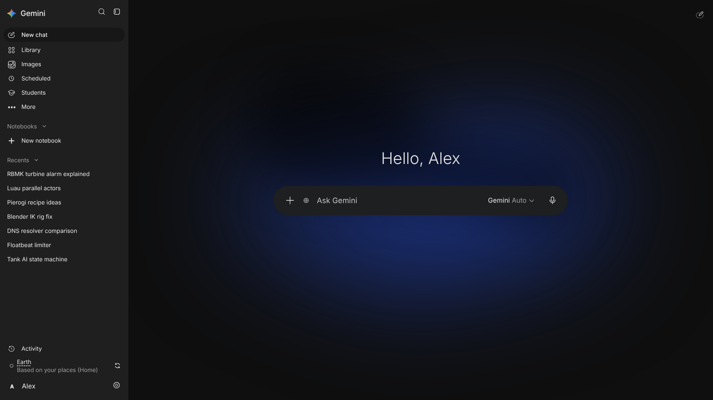
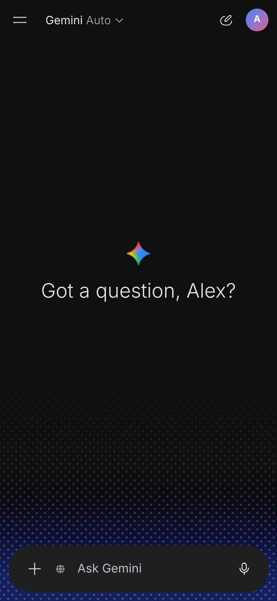

# Gemini Studio

 

> **This is not an official Google product.** It is an independent project that copies the look of the Gemini web and phone apps. Google does not make, endorse or support it.

Gemini Studio is a chat app in one HTML file. It looks and works like the Gemini app, but it talks to the AI providers directly from your browser, with your own API keys. It has no server.

**Open the app:** https://anotherrandompersonlol.github.io/gemini-studio/

Most of the code was written with Claude (Anthropic), from screenshots and screen recordings of the real Gemini app.

## Features

- Chat with streaming replies, Markdown, code blocks with syntax highlighting, and token counts.
- Seven providers: Gemini, Claude, ChatGPT, DeepSeek, Qwen, Kimi and Llama. You can also add a custom OpenAI-compatible endpoint.
- Gemini Auto: the app picks Flash for everyday prompts and Pro for long or technical prompts. You can also select a model and a thinking level.
- Several keys for each provider. When a key hits its rate limit, the app can switch to the next key.
- Image creation with Nano Banana models, aspect ratio and photo templates.
- The **@** menu: call one of your skills for a message.
- Temporary chats that are not saved.
- Notebooks, pinned chats, chat search, Library (images and exports), Scheduled prompts, Students (guided learning) and Customize (skills).
- Optional location (typed, from your device, or from your IP address) for weather and local questions.
- Desktop and phone layouts, dark and light themes.
- Export and import of all chats as a JSON file.

## Requirements

- A current desktop or phone browser, for example Chrome, Edge, Firefox or Samsung Internet.
- An API key from at least one provider.

## Get started

1. Open the app.
2. Get a Gemini API key from [Google AI Studio](https://aistudio.google.com/apikey). Gemini has a free tier.
3. In the app, type a message and send it. The app asks for the key.
4. Paste the key and click **Save key**.

To add more keys, click the gear button, then **Settings** > **API keys**.

### Keys for other providers

| Provider | Where to get a key | Detected from the key |
|---|---|---|
| Gemini | [Google AI Studio](https://aistudio.google.com/apikey) | Yes |
| Claude | [Claude Console](https://console.anthropic.com/settings/keys) | Yes (`sk-ant-`) |
| ChatGPT | [OpenAI dashboard](https://platform.openai.com/api-keys) | No, select the provider |
| DeepSeek | [DeepSeek platform](https://platform.deepseek.com/api_keys) | No, select the provider |
| Qwen | [Alibaba Cloud Model Studio](https://modelstudio.console.alibabacloud.com/) (international) | No, select the provider |
| Kimi | [Moonshot AI platform](https://platform.moonshot.ai/console/api-keys) (international) | No, select the provider |
| Llama | [Llama Developer](https://llama.developer.meta.com/) | Usually (`LLM\|`). If not, select the provider |

DeepSeek, Qwen, Kimi and ChatGPT keys all start with `sk-`, and a key without a known start is taken as a Gemini key. Select the provider in the list next to the key box before you click **Add key**.

Qwen and Kimi keys work only in their own region. The app uses the international addresses, so a key from the China site does not work.

### Test a key

In **Settings** > **API keys**, click **Test**. The result tells you, for each provider:

- if the browser can reach it,
- if the key is accepted,
- if the provider allows chat requests from a web page.

## Known limits

- **ChatGPT does not work from a web page at the moment.** OpenAI's server rejects chat requests that come straight from a browser. To use ChatGPT, send its requests through your own proxy with **Custom endpoint** in Settings.
- **Image creation needs billing.** The Gemini free tier does not include image models.
- **Google features are not available.** Gmail, Drive, Calendar, Keep and the other connectors need Google's sign-in, which this app does not have. The **@** menu shows them, but they do not connect.
- **Scheduled prompts run only while the page is open.**
- **Your data is only in this browser.** If you clear the site data, your chats are lost. Export a backup from **Settings** > **Privacy & about**.

## Privacy

- Your API keys, chats, notebooks, skills and settings are saved only in the local storage of your browser.
- Each key goes only to its own provider, or to the custom endpoint that you set.
- Each provider's own data rules apply, the same as when you use its API in any other way. A free-tier Gemini key can let Google use your prompts to improve its products. **Settings** > **Privacy & about** has a summary and links.
- See [SECURITY.md](SECURITY.md) for the full list of addresses that the page connects to.

## Run it yourself

The app is one file and needs no build.

- **On your computer:** download `index.html` and open it in your browser.
- **On GitHub Pages:** fork this repository, then open **Settings** > **Pages**, select **Deploy from a branch**, and select `main` and `/ (root)`.

## Report a problem

Use the [bug report form](../../issues/new/choose). Do not paste API keys in an issue. See [CONTRIBUTING.md](CONTRIBUTING.md).

## License

[MIT](LICENSE). Gemini, Google and the other product names and logos belong to their owners. This project uses them only to show which provider a key or a model is for.
